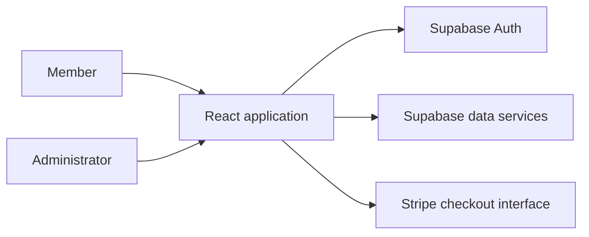

<div align="center">

# FitFlex

### A connected workspace for fitness communities

Member accounts, class bookings, attendance, engagement, and membership interfaces.


[Hosted application](https://fitflex-new.vercel.app/) · [Membership setup](MEMBERSHIP_SETUP.md) · [Stripe integration notes](STRIPE_TESTING_GUIDE.md)

</div>

---

FitFlex brings everyday fitness-community workflows into a member-facing application, with a separate set of administrative screens. The code demonstrates authentication, database-backed product features, reusable layouts, and a broad set of member engagement interfaces.

**Repository scope:** this public version is a **React/Create React App application**, not a Next.js app. It connects directly to Supabase. Membership and payment screens include demonstration behavior; this repository does not include a complete production billing backend.

## Screenshots

Actual application screens captured locally with fictional member, XP, and class records. Backend responses are simulated for this demo.

### Member dashboard

XP progress, level milestones, daily challenges, and shortcuts to member features.


### Fitness classes

Searchable class listings with type and level filters, schedules, locations, capacity, and booking controls.


<details>
<summary><strong>View public sign-in screen</strong></summary>


</details>

## Product areas

| Area | Workflows represented in the code |
| --- | --- |
| **Member access** | Signup, login, password reset, session persistence, profile and settings. |
| **Classes** | Class listings, details, booking interfaces, and admin class management. |
| **Attendance** | Member check-in/history interfaces and administrative attendance views. |
| **Engagement** | XP rewards, leaderboards, referrals, and weekly feedback. |
| **Membership** | Plan selection, monthly/yearly pricing, checkout redirection, and membership history interfaces. |
| **Store** | Member store and administrative store screens. |

The project uses shared layouts, React context providers, route guards, service modules, and Supabase-backed records. Admin route guards improve navigation; database policies must enforce the actual access rules.

## How the pieces fit



**Stack:** React 19, TypeScript, React Router 6, Tailwind CSS 3, Radix UI components, Framer Motion, Supabase JS, and Stripe JS. The build tool is `react-scripts` 5.

## Run locally

You need Node.js/npm and a Supabase project configured for this application. The locked `react-scripts` package declares Node.js 14+; that is its package minimum, not a guarantee that every dependency works on every newer runtime.

```bash
git clone https://github.com/VanshMehta1234/Fitflex-New.git
cd Fitflex-New
npm ci
```

Create `.env` in the repository root:

```dotenv
REACT_APP_SUPABASE_URL=https://your-project.supabase.co
REACT_APP_SUPABASE_ANON_KEY=your-browser-safe-anon-key
```

Then run:

```bash
npm start
```

Open [localhost:3000](http://localhost:3000). The existing `.env.example` contains commented Stripe examples; it does not currently provide the two required Supabase variables above.

### Database prerequisites

The frontend expects an existing schema, policies, storage configuration, and helper functions. Service modules reference records such as `profiles`, `attendance`, `classes`, `class_bookings`, `membership_plans`, `memberships`, and payment history. Other engagement/store features have additional requirements.

**This checkout has no SQL migration files.** Older instructions referenced `database-setup.sql` and `fix-profiles-table.sql`, but those files are not included. Obtain the matching database setup from the project owner before expecting a fresh Supabase project to support all screens. Do not substitute an incomplete schema based only on the table names listed here.

Enable the appropriate email authentication flow, configure redirect URLs for local and hosted environments, and verify database access policies and storage permissions. Only browser-safe Supabase credentials belong in `REACT_APP_` values; service-role and payment secret keys belong on a server.

## Membership and billing status

| Implemented interface | Current boundary |
| --- | --- |
| Plan and billing-cycle selection | Can fall back to local sample plans when database reads fail. |
| Stripe checkout redirection | Uses configured or fallback test identifiers; production payment behavior requires separate verification. |
| Cancellation, pause, and resume controls | The Stripe service returns simulated success for these operations. |
| Customer portal | Shows a demo-mode message rather than creating a server-side portal session. |
| Payment methods and invoices | Stripe service helpers return sample data. |

For checkout evaluation, set your own **test** publishable key and price IDs rather than relying on checked-in fallbacks. The service reads:

```dotenv
REACT_APP_STRIPE_PUBLISHABLE_KEY=your-test-publishable-key
REACT_APP_STRIPE_BASIC_MONTHLY_PRICE_ID=your-test-price-id
REACT_APP_STRIPE_BASIC_YEARLY_PRICE_ID=your-test-price-id
REACT_APP_STRIPE_PREMIUM_MONTHLY_PRICE_ID=your-test-price-id
REACT_APP_STRIPE_PREMIUM_YEARLY_PRICE_ID=your-test-price-id
REACT_APP_STRIPE_ELITE_MONTHLY_PRICE_ID=your-test-price-id
REACT_APP_STRIPE_ELITE_YEARLY_PRICE_ID=your-test-price-id
```

See the [Stripe guide](STRIPE_TESTING_GUIDE.md) for historical integration context. A production rollout needs authoritative server-side subscription state, verified webhooks, and real subscription-management endpoints.

## Code map

```text
src/
  App.tsx        Routes and provider composition
  supabase.ts    Supabase browser client
  pages/         Member and admin screens
  components/    Shared layouts, route guards and UI
  context/       Auth, classes, attendance, membership and engagement state
  lib/           Database services and Stripe integration helpers
  types/         Product data types
public/          Static application assets
```

## Build and review

| Command | Purpose |
| --- | --- |
| `npm start` | Start development server. |
| `npm run build` | Produce the static `build/` directory. |
| `npm test` | Run the existing React Scripts test runner; this is not full product coverage. |

For static hosting, publish `build/`, provide the environment variables at build time, and configure an SPA fallback to `index.html` for direct route loads.

A useful handover walkthrough covers account creation/reset, member/admin access, class booking, attendance, and membership screens against a matching development database. Verify billing separately from the demo UI.

---

Built by **Vansh Mehta** · [Portfolio](https://www.builtbyvansh.com/) · [Discuss a SaaS project](mailto:founder@builtbyvansh.com)
